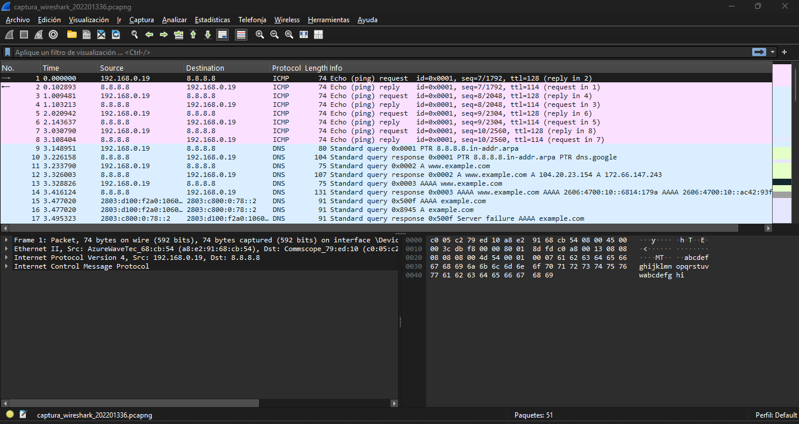
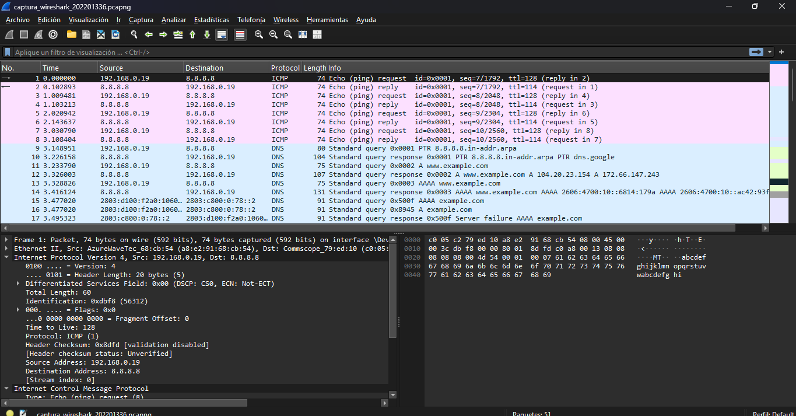
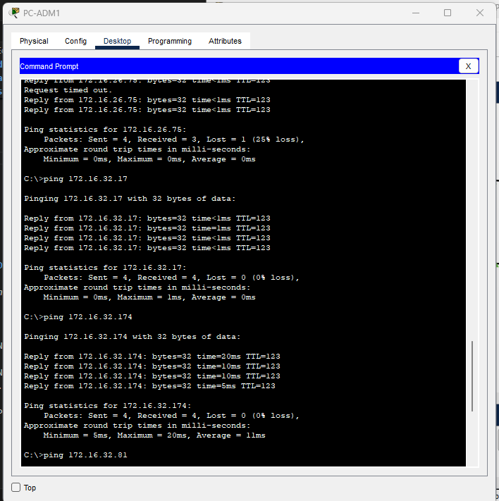
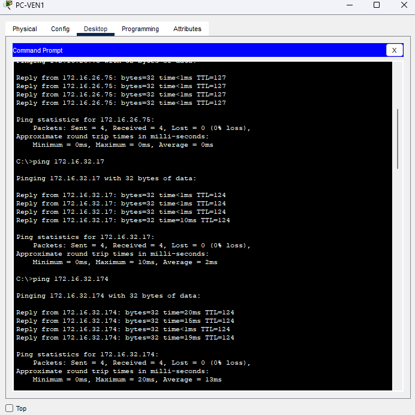
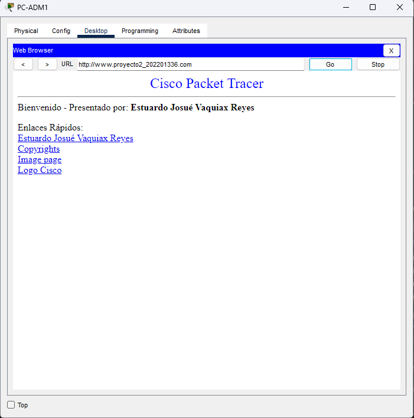
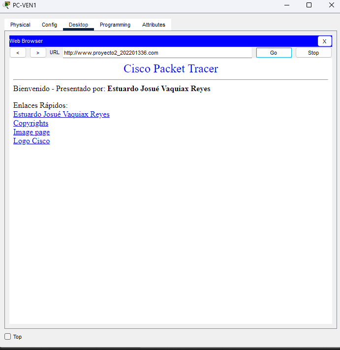
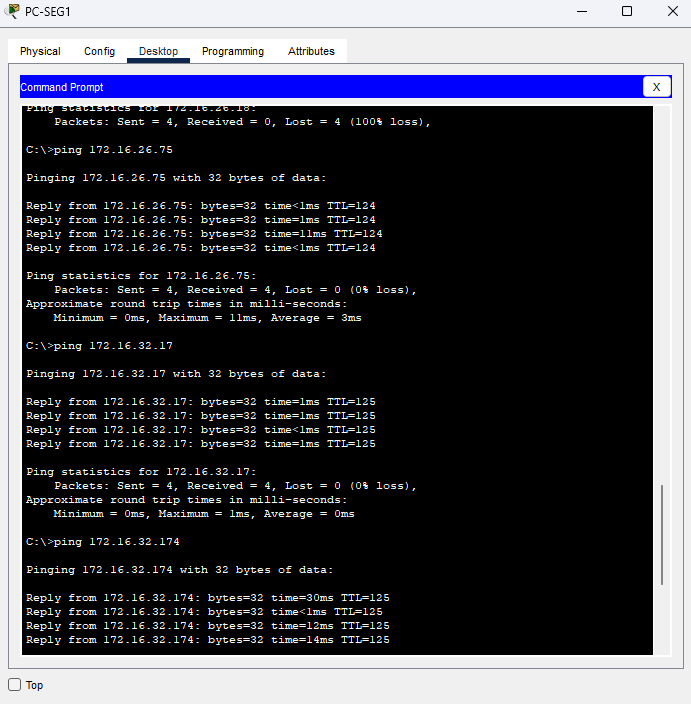

# Manual Técnico de Infraestructura de Red
## Proyecto Conectividad XXI: Integración de Operadores Nacionales
### Redes de Computadoras 2 — Segundo Semestre 2026
**Facultad de Ingeniería, Escuela de Ciencias y Sistemas (ECYS)**
**Universidad de San Carlos de Guatemala**

---

### Ficha Técnica del Estudiante y Entrega
* **Estudiante:** Estuardo
* **Carné:** 202201336
* **Curso:** Redes de Computadoras 2 (Código: 975)
* **Docente / Auxiliares:** Laboratorio de Redes 2
* **Entorno de Simulación:** Cisco Packet Tracer v8.2+
* **Archivo de Simulación:** `Proyecto2_202201336.pkt`
* **Archivo de Captura Wireshark:** `Wireshark/captura_wireshark_202201336.pcapng`
* **Presentación Ejecutiva:** `Proyecto2_Presentacion_202201336.pdf`
* **Dominio Corporativo Configurado:** `www.proyecto2_202201336.com`
* **Servidor Central de DHCP:** `172.16.26.130` (Alojado en ISP 2: AndinaCom)

---

## Índice de Contenidos
1. [Resumen Ejecutivo y Arquitectura Global](#1-resumen-ejecutivo-y-arquitectura-global)
2. [Marco Teórico y Justificación de Protocolos](#2-marco-teórico-y-justificación-de-protocolos)
3. [Topologías de Red y Mapeo Físico](#3-topologías-de-red-y-mapeo-físico)
4. [Memoria de Cálculo y Plan de Direccionamiento VLSM](#4-memoria-de-cálculo-y-plan-de-direccionamiento-vlsm)
5. [Tabla Maestra de Direccionamiento por Interfaz](#5-tabla-maestra-de-direccionamiento-por-interfaz)
6. [Configuraciones CLI Aplicadas por Dispositivo](#6-configuraciones-cli-aplicadas-por-dispositivo)
7. [Políticas de Seguridad y Justificación de ACLs Extendidas](#7-políticas-de-seguridad-y-justificación-de-acls-extendidas)
8. [Análisis Forense de Tráfico con Wireshark](#8-análisis-forense-de-tráfico-con-wireshark)
9. [Evidencias de Pruebas y Validación en Packet Tracer](#9-evidencias-de-pruebas-y-validación-en-packet-tracer)
10. [Guía de Diagnóstico y Comandos de Verificación (Troubleshooting)](#10-guía-de-diagnóstico-y-comandos-de-verificación-troubleshooting)
11. [Conclusiones y Recomendaciones Técnicas](#11-conclusiones-y-recomendaciones-técnicas)

---

## 1. Resumen Ejecutivo y Arquitectura Global

El proyecto consiste en el diseño, dimensionamiento, configuración y validación de una red de telecomunicaciones a nivel nacional que interconecta tres Proveedores de Servicios de Internet (ISPs) líderes: **FibraNet GT**, **AndinaCom** y **MoonLink**.

La red nacional está gobernada por un núcleo de enrutamiento exterior **BGP (Border Gateway Protocol)** que garantiza la autonomía de cada operador (Sistemas Autónomos AS 65001, AS 65002 y AS 65003). La interconexión física entre los tres operadores se realiza mediante un anillo en triángulo de enlaces de **fibra óptica monomodo**, asegurando redundancia de ruta, conmutación dinámica ante fallos y cero dependencia de enlaces de tránsito externos.

### Resumen por Proveedor de Servicios:
* **ISP 1 (FibraNet GT - AS 65001):** Topología en **Árbol de tres niveles**, enrutamiento interno con **OSPFv2 (Área 0)**, agregación de enlaces **LACP (802.3ad)** en sus switches de acceso, y provisión centralizada de los servicios **DNS y HTTP/HTTPS** bajo el dominio `www.proyecto2_202201336.com`.
* **ISP 2 (AndinaCom - AS 65002):** Topología **Jerárquica clásica** (Núcleo, Distribución y Acceso), enrutamiento interno con **OSPFv2**, alta disponibilidad en Capa 3 mediante **HSRP (Hot Standby Router Protocol)** con balanceo activo/standby entre VLANs, y aprovisionamiento de direccionamiento dinámico **DHCP centralizado** para todos los departamentos del país.
* **ISP 3 (MoonLink - AS 65003):** Topología **Hub-and-Spoke**, enrutamiento interno con **EIGRP (AS 100)** de rápida convergencia, agregación de enlaces **LACP**, y red de acceso **Wi-Fi** para usuarios móviles y ventas a clientes finales.

---

## 2. Marco Teórico y Justificación de Protocolos

### 2.1 BGP (Border Gateway Protocol) en el Núcleo
BGPv4 es el estándar de facto para el enrutamiento interdominio en Internet. A diferencia de los protocolos IGP, BGP es un protocolo de vector de rutas (Path Vector) que intercambia información de alcanzabilidad entre Sistemas Autónomos mediante sesiones TCP en el puerto **179**. Se seleccionó para la interconexión inter-ISP porque:
* Permite aislar completamente las tablas de enrutamiento internas de cada operador.
* Ofrece control total sobre la importación y exportación de prefijos mediante atributos y políticas de filtrado.
* Evita que fluctuaciones internas (link flapping en OSPF o EIGRP) desestabilicen a los operadores vecinos.

### 2.2 OSPFv2 (Open Shortest Path First) en ISP 1 e ISP 2
OSPF es un protocolo de estado de enlace (Link-State) basado en el algoritmo de Dijkstra (SPF):
* **Convergencia Rápida:** Ante cambios topológicos, propaga inmediatamente Link State Advertisements (LSAs) sin bucles de enrutamiento.
* **Estructura Jerárquica:** Opera bajo el Área 0 (Backbone Area), lo que resulta ideal para la topología en árbol de FibraNet GT y la arquitectura jerárquica de AndinaCom.
* **Métrica Basada en Costo:** Calcula la mejor ruta en función del ancho de banda real de los enlaces Gigabit y FastEthernet.

### 2.3 EIGRP (Enhanced Interior Gateway Routing Protocol) en ISP 3
EIGRP es un protocolo híbrido avanzado propietario de Cisco (abierto como RFC 7868) basado en el algoritmo DUAL (Diffusing Update Algorithm):
* **Convergencia Instantánea:** Mantiene una tabla de topología con sucesores factibles (Feasible Successors), permitiendo conmutar a una ruta de respaldo en milisegundos sin recalcular la ruta completa.
* **Eficiencia en Topologías Hub-and-Spoke:** Consume mínimo ancho de banda al enviar actualizaciones parciales acotadas solo cuando ocurre un cambio físico.

### 2.4 HSRP (Hot Standby Router Protocol - RFC 2281)
Protocolo de redundancia de primer salto (FHRP) de Capa 3 implementado en AndinaCom:
* Proporciona una dirección IP virtual (VIP) y una MAC virtual que comparten los routers `A-DIST1` y `A-DIST2`.
* Los clientes en la LAN configuran la VIP como su Gateway predeterminado.
* Si el router Activo sufre una falla, el router en Standby asume la VIP de forma transparente tras perder 3 mensajes de Hello (aproximadamente 3 segundos), garantizando cero interrupciones en los servicios de Facturación y Ventas.

### 2.5 LACP (Link Aggregation Control Protocol - IEEE 802.3ad)
Estándar abierto de agregación de enlaces de Capa 2:
* Agrupa múltiples enlaces físicos FastEthernet en un único canal lógico (**Port-Channel**).
* Duplica el ancho de banda efectivo a 200 Mbps full-duplex y ofrece tolerancia a fallos: si un cable físico se desconecta, el tráfico continúa fluyendo por el otro sin caída del canal ni bucles de Spanning Tree.

---

## 3. Topologías de Red y Mapeo Físico

### 3.1 Interconexión BGP Inter-ISP (Triángulo de Fibra Óptica)
Los switches multicapa de borde Catalyst 3650-24PS se comunican por sus puertos SFP dedicados (`Gig1/1/1` y `Gig1/1/2`) con cables ópticos:

```
                        [ F-R1 (FibraNet GT) ]
                              (AS 65001)
                             Gi1/1/1  Gi1/1/2
                             /              \
         192.168.36.0/30    /                \    192.168.36.8/30
          (Fibra Óptica)   /                  \   (Fibra Óptica)
                          /                    \
                    Gi1/1/1                    Gi1/1/2
          [ A-CORE1 (AndinaCom) ] --------- [ M-HUB (MoonLink) ]
                (AS 65002)     Gi1/1/2    Gi1/1/1    (AS 65003)
                             192.168.36.4/30
                              (Fibra Óptica)
```

---

### 3.2 ISP 1: FibraNet GT (Topología en Árbol)
Diseño estrictamente ramificado sin bucles de conmutación:

```
                          F-R1 (Catalyst 3650, Raíz y Borde BGP)
                         /                                      \
             F-R2 (Cisco 2911, Rama Admin)         F-R3 (Cisco 2911, Rama Atención)
                        |                                       |
             F-R4 (Cisco 2911, GW Admin)            F-R5 (Cisco 2911, GW Atención)
                        |                                       |
             F-SW1A ======== F-SW1B                 F-SW2A ======== F-SW2B
                  (LACP Po1)                             (LACP Po2)
               /          \                           /          \
        F-DNS-HTTP     PC-ADM1, 2                 PC-ATC1       PC-ATC2, 3
```

---

### 3.3 ISP 2: AndinaCom (Topología Jerárquica con HSRP)
Capa de Núcleo (Core), Capa de Distribución con HSRP activo/standby cruzado y Capa de Acceso:

```
               A-CORE1 (Borde BGP) =========== A-CORE2 (Núcleo)
                     \       \      (LACP Po1)      /       /
                      \       \                    /       /
                       \       \__________________/       /
                        \______  \              /  ______/
                               \  \            /  /
                           A-DIST1 ============ A-DIST2
                                (HSRP Activo/Standby)
                               /                    \
                 A-ACC1 (Ventas)                   A-ACC2 (Facturación)
                    |                                 |
              PC-VEN1, PC-VEN2                  PC-FAC1, PC-FAC2
               A-DHCP (Server)
```

---

### 3.4 ISP 3: MoonLink (Topología Hub-and-Spoke con Wi-Fi)
Nodo central radiante conectado exclusivamente a los routers remotos (spokes):

```
                                M-HUB (Catalyst 3650, Central)
                    /              |               |               \
               M-SP1 (2911)   M-SP2 (2911)    M-SP3 (2911)    M-SP4 (2911)
                (Soporte)      (Seguridad)    (Soporte Wi-Fi) (Seguridad 2)
                    |              |               |               |
               M-SW1A==M-SW1B M-SW2A==M-SW2B     M-SW3           M-SW4
                 (LACP Po1)     (LACP Po2)         |               |
                    |              |             M-WIFI         PC-SEG3
               PC-SOP1, 2     PC-SEG1, 2           )))
                                              Laptop-WIFI
```

---

## 4. Memoria de Cálculo y Plan de Direccionamiento VLSM

### 4.1 Cálculo Matemático Basado en Carné (`202201336`)
* **Primer dígito del carné ($P$):** `2`
* **Último dígito del carné ($U$):** `6`
* **Últimos dos dígitos del carné ($XX$):** `36`

#### Fórmulas de Asignación del Enunciado:
1. **Red de Interconexión BGP:** `192.168.XX.0/16` $\rightarrow$ `192.168.36.0/16`. Se utiliza el bloque `192.168.36.0/24` subdividido en máscaras `/30` para optimizar el direccionamiento.
2. **ISP 1 (FibraNet GT):** `172.16.1U.0/24` $\rightarrow$ `172.16.16.0/24`.
   * Requisito: Dos departamentos (Administración y Atención al Cliente) con hasta 75 hosts cada uno.
   * Fórmula de dimensionamiento: $2^h - 2 \ge 75 \implies h = 7 \implies 2^7 - 2 = 126 \ge 75$.
   * Máscara requerida: $32 - 7 = /25$ (`255.255.255.128`).
   * División: Dos subredes `/25` cubren exactamente el espacio de `172.16.16.0/24`.
3. **ISP 2 (AndinaCom):** `172.16.2U.0/24` $\rightarrow$ `172.16.26.0/24`.
   * Requisito: Tamaño a discreción del estudiante.
   * Se dimensiona con máscaras `/26` (62 hosts útiles por departamento), dejando espacio libre para la LAN de servidores/DHCP (`/28`).
4. **ISP 3 (MoonLink):** `172.16.3P.0/24` $\rightarrow$ `172.16.32.0/24`.
   * Requisito: Departamentos de hasta 45 hosts.
   * Fórmula: $2^h - 2 \ge 45 \implies h = 6 \implies 2^6 - 2 = 62 \ge 45$.
   * Máscara requerida: $32 - 6 = /26$ (`255.255.255.192`).
   * División: Cuatro subredes `/26` para Soporte, Seguridad, Soporte Wi-Fi y Seguridad Sede 2.

---

### 4.2 Subneteo de Departamentos y LANs

| ISP / Departamento | Red Asignada | Máscara Decimal | Gateway | Broadcast | Rango DHCP Útil | Capacidad Hosts |
| :--- | :--- | :--- | :--- | :--- | :--- | :--- |
| **ISP 1: Administración** | `172.16.16.0/25` | `255.255.255.128` | `172.16.16.1` | `172.16.16.127` | `172.16.16.10 - .126` | 126 hosts |
| **ISP 1: Atención Cliente**| `172.16.16.128/25`| `255.255.255.128` | `172.16.16.129` | `172.16.16.255` | `172.16.16.135 - .254` | 126 hosts |
| **ISP 2: Ventas** | `172.16.26.0/26` | `255.255.255.192` | `172.16.26.1` (VIP) | `172.16.26.63` | `172.16.26.10 - .62` | 62 hosts |
| **ISP 2: Facturación** | `172.16.26.64/26` | `255.255.255.192` | `172.16.26.65` (VIP)| `172.16.26.127` | `172.16.26.75 - .126` | 62 hosts |
| **ISP 2: Servidores / DHCP**| `172.16.26.128/28`| `255.255.255.240` | `172.16.26.129` | `172.16.26.143` | `172.16.26.130 (Estático)`| 14 hosts |
| **ISP 3: Soporte (Sede 1)**| `172.16.32.0/26` | `255.255.255.192` | `172.16.32.1` | `172.16.32.63` | `172.16.32.10 - .62` | 62 hosts |
| **ISP 3: Seguridad (Sede 1)**|`172.16.32.64/26` | `255.255.255.192` | `172.16.32.65` | `172.16.32.127` | `172.16.32.75 - .126` | 62 hosts |
| **ISP 3: Soporte (Wi-Fi)** | `172.16.32.128/26`| `255.255.255.192` | `172.16.32.129` | `172.16.32.191` | `172.16.32.135 - .190` | 62 hosts |
| **ISP 3: Seguridad (Sede 2)**|`172.16.32.192/26`| `255.255.255.192` | `172.16.32.193` | `172.16.32.255` | `172.16.32.200 - .254` | 62 hosts |

---

### 4.3 Tabla de Enlaces Punto a Punto (/30) — Red `192.168.36.0/24`

| Bloque /30 | Subred | Máscara | Extremo A | IP A | Extremo B | IP B | Propósito |
| :--- | :--- | :--- | :--- | :--- | :--- | :--- | :--- |
| **BGP-1** | `192.168.36.0/30` | `255.255.255.252` | `F-R1` Gi1/1/1 | `.1` | `A-CORE1` Gi1/1/1 | `.2` | Troncal BGP Fibra Óptica |
| **BGP-2** | `192.168.36.4/30` | `255.255.255.252` | `A-CORE1` Gi1/1/2 | `.5` | `M-HUB` Gi1/1/1 | `.6` | Troncal BGP Fibra Óptica |
| **BGP-3** | `192.168.36.8/30` | `255.255.255.252` | `M-HUB` Gi1/1/2 | `.9` | `F-R1` Gi1/1/2 | `.10`| Troncal BGP Fibra Óptica |
| **ISP1-1**| `192.168.36.12/30`| `255.255.255.252` | `F-R1` Gi1/0/1 | `.13`| `F-R2` Gi0/0 | `.14`| Troncal OSPF Rama Admin |
| **ISP1-2**| `192.168.36.16/30`| `255.255.255.252` | `F-R1` Gi1/0/2 | `.17`| `F-R3` Gi0/0 | `.18`| Troncal OSPF Rama Atención |
| **ISP1-3**| `192.168.36.20/30`| `255.255.255.252` | `F-R2` Gi0/1 | `.21`| `F-R4` Gi0/0 | `.22`| Enlace OSPF Acceso Admin |
| **ISP1-4**| `192.168.36.24/30`| `255.255.255.252` | `F-R3` Gi0/1 | `.25`| `F-R5` Gi0/0 | `.26`| Enlace OSPF Acceso Atención |
| **ISP2-1**| `192.168.36.28/30`| `255.255.255.252` | `A-CORE1` Gi1/0/1 | `.29`| `A-DIST1` Gi1/0/1 | `.30`| OSPF Núcleo a Distribución 1 |
| **ISP2-2**| `192.168.36.32/30`| `255.255.255.252` | `A-CORE1` Gi1/0/2 | `.33`| `A-DIST2` Gi1/0/1 | `.34`| OSPF Núcleo a Distribución 2 |
| **ISP2-3**| `192.168.36.36/30`| `255.255.255.252` | `A-CORE2` Gi1/0/1 | `.37`| `A-DIST1` Gi1/0/2 | `.38`| OSPF Núcleo 2 a Dist 1 |
| **ISP2-4**| `192.168.36.40/30`| `255.255.255.252` | `A-CORE2` Gi1/0/2 | `.41`| `A-DIST2` Gi1/0/2 | `.42`| OSPF Núcleo 2 a Dist 2 |
| **ISP2-5**| `192.168.36.44/30`| `255.255.255.252` | `A-CORE1` Po1 | `.45`| `A-CORE2` Po1 | `.46`| LACP EtherChannel Núcleo L3 |
| **ISP2-6**| `192.168.36.48/30`| `255.255.255.252` | `A-CORE1` Gi1/0/3 | `.49`| `A-SRV-GW` Gi0/0 | `.50`| Enlace hacia Servidor DHCP |
| **ISP3-1**| `192.168.36.56/30`| `255.255.255.252` | `M-HUB` Gi1/0/1 | `.57`| `M-SP1` Gi0/0 | `.58`| EIGRP Spoke Soporte |
| **ISP3-2**| `192.168.36.60/30`| `255.255.255.252` | `M-HUB` Gi1/0/2 | `.61`| `M-SP2` Gi0/0 | `.62`| EIGRP Spoke Seguridad |
| **ISP3-3**| `192.168.36.64/30`| `255.255.255.252` | `M-HUB` Gi1/0/3 | `.65`| `M-SP3` Gi0/0 | `.66`| EIGRP Spoke Soporte Wi-Fi |
| **ISP3-4**| `192.168.36.68/30`| `255.255.255.252` | `M-HUB` Gi1/0/4 | `.69`| `M-SP4` Gi0/0 | `.70`| EIGRP Spoke Seguridad 2 |

---

## 5. Tabla Maestra de Direccionamiento por Interfaz

| Dispositivo | Modelo | Interfaz | Dirección IP | Máscara | Gateway | Función Técnica |
| :--- | :--- | :--- | :--- | :--- | :--- | :--- |
| **F-R1** | Catalyst 3650 | Gi1/1/1 | `192.168.36.1` | `255.255.255.252` | N/A | BGP hacia A-CORE1 (Fibra) |
| | | Gi1/1/2 | `192.168.36.10`| `255.255.255.252` | N/A | BGP hacia M-HUB (Fibra) |
| | | Gi1/0/1 | `192.168.36.13`| `255.255.255.252` | N/A | OSPF hacia F-R2 |
| | | Gi1/0/2 | `192.168.36.17`| `255.255.255.252` | N/A | OSPF hacia F-R3 |
| **F-R2** | Cisco 2911 | Gi0/0 | `192.168.36.14`| `255.255.255.252` | N/A | OSPF hacia F-R1 |
| | | Gi0/1 | `192.168.36.21`| `255.255.255.252` | N/A | OSPF hacia F-R4 |
| **F-R3** | Cisco 2911 | Gi0/0 | `192.168.36.18`| `255.255.255.252` | N/A | OSPF hacia F-R1 |
| | | Gi0/1 | `192.168.36.25`| `255.255.255.252` | N/A | OSPF hacia F-R5 |
| **F-R4** | Cisco 2911 | Gi0/0 | `192.168.36.22`| `255.255.255.252` | N/A | OSPF hacia F-R2 |
| | | Gi0/1 | `172.16.16.1` | `255.255.255.128` | N/A | Gateway Administración LAN |
| **F-R5** | Cisco 2911 | Gi0/0 | `192.168.36.26`| `255.255.255.252` | N/A | OSPF hacia F-R3 |
| | | Gi0/1 | `172.16.16.129`| `255.255.255.128` | N/A | Gateway Atención al Cliente LAN |
| **A-CORE1** | Catalyst 3650 | Gi1/1/1 | `192.168.36.2` | `255.255.255.252` | N/A | BGP hacia F-R1 (Fibra) |
| | | Gi1/1/2 | `192.168.36.5` | `255.255.255.252` | N/A | BGP hacia M-HUB (Fibra) |
| | | Port-Channel 1| `192.168.36.45`| `255.255.255.252`| N/A | LACP L3 hacia A-CORE2 |
| | | Gi1/0/1 | `192.168.36.29`| `255.255.255.252` | N/A | OSPF hacia A-DIST1 |
| | | Gi1/0/2 | `192.168.36.33`| `255.255.255.252` | N/A | OSPF hacia A-DIST2 |
| | | Gi1/0/3 | `192.168.36.49`| `255.255.255.252` | N/A | OSPF hacia A-SRV-GW |
| **A-CORE2** | Catalyst 3650 | Port-Channel 1| `192.168.36.46`| `255.255.255.252`| N/A | LACP L3 hacia A-CORE1 |
| | | Gi1/0/1 | `192.168.36.37`| `255.255.255.252` | N/A | OSPF hacia A-DIST1 |
| | | Gi1/0/2 | `192.168.36.41`| `255.255.255.252` | N/A | OSPF hacia A-DIST2 |
| **A-DIST1** | Catalyst 3650 | Vlan 10 | `172.16.26.2`  | `255.255.255.192` | N/A | HSRP Activo Ventas (VIP 172.16.26.1) |
| | | Vlan 20 | `172.16.26.66` | `255.255.255.192` | N/A | HSRP Standby Fact. (VIP 172.16.26.65) |
| **A-DIST2** | Catalyst 3650 | Vlan 10 | `172.16.26.3`  | `255.255.255.192` | N/A | HSRP Standby Ventas (VIP 172.16.26.1) |
| | | Vlan 20 | `172.16.26.67` | `255.255.255.192` | N/A | HSRP Activo Fact. (VIP 172.16.26.65) |
| **A-SRV-GW**| Cisco 2911 | Gi0/0 | `192.168.36.50`| `255.255.255.252` | N/A | OSPF hacia A-CORE1 |
| | | Gi0/2 | `172.16.26.129`| `255.255.255.240` | N/A | Gateway Servidores / DHCP |
| **M-HUB** | Catalyst 3650 | Gi1/1/1 | `192.168.36.6` | `255.255.255.252` | N/A | BGP hacia A-CORE1 (Fibra) |
| | | Gi1/1/2 | `192.168.36.9` | `255.255.255.252` | N/A | BGP hacia F-R1 (Fibra) |
| | | Gi1/0/1 a 4| `.57, .61, .65, .69`| `255.255.255.252`| N/A | EIGRP hacia Spokes 1 a 4 |
| **M-SP1** | Cisco 2911 | Gi0/1 | `172.16.32.1`  | `255.255.255.192` | N/A | Gateway Soporte (Sede 1) |
| **M-SP2** | Cisco 2911 | Gi0/1 | `172.16.32.65` | `255.255.255.192` | N/A | Gateway Seguridad (Sede 1)|
| **M-SP3** | Cisco 2911 | Gi0/1 | `172.16.32.129`| `255.255.255.192` | N/A | Gateway Soporte (Wi-Fi) |
| **M-SP4** | Cisco 2911 | Gi0/1 | `172.16.32.193`| `255.255.255.192` | N/A | Gateway Seguridad (Sede 2)|
| **F-DNS-HTTP**| Server-PT | FastEthernet0 | `172.16.16.2` | `255.255.255.128` | `172.16.16.1` | Servidor Web y DNS Nacional |
| **A-DHCP** | Server-PT | FastEthernet0 | `172.16.26.130`| `255.255.255.240` | `172.16.26.129`| Servidor DHCP Centralizado |
| **PC-ADM1** | PC-PT | FastEthernet0 | Dinámica (DHCP)| `255.255.255.128` | `172.16.16.1` | Cliente Administración (ISP 1) |
| **PC-ATC1** | PC-PT | FastEthernet0 | Dinámica (DHCP)| `255.255.255.128` | `172.16.16.129`| Cliente Atención al Cliente (ISP 1) |
| **PC-VEN1** | PC-PT | FastEthernet0 | Dinámica (DHCP)| `255.255.255.192` | `172.16.26.1` | Cliente Ventas (ISP 2) |
| **PC-FAC1** | PC-PT | FastEthernet0 | Dinámica (DHCP)| `255.255.255.192` | `172.16.26.65` | Cliente Facturación (ISP 2) |
| **PC-SOP1** | PC-PT | FastEthernet0 | Dinámica (DHCP)| `255.255.255.192` | `172.16.32.1` | Cliente Soporte (ISP 3) |
| **PC-SEG1** | PC-PT | FastEthernet0 | Dinámica (DHCP)| `255.255.255.192` | `172.16.32.65` | Cliente Seguridad (ISP 3) |
| **Laptop-WIFI**| Laptop-PT | Wireless0 | Dinámica (DHCP)| `255.255.255.192` | `172.16.32.129`| Cliente Móvil Wi-Fi (ISP 3) |

---

## 6. Configuraciones CLI Aplicadas por Dispositivo

### 6.1 Núcleo BGP e Interconexión Inter-ISP

```text
! ==========================================================
! F-R1 (Borde BGP FibraNet GT - AS 65001)
! ==========================================================
enable
configure terminal
hostname F-R1
ip routing

interface GigabitEthernet1/1/1
 no switchport
 ip address 192.168.36.1 255.255.255.252
 no shutdown

interface GigabitEthernet1/1/2
 no switchport
 ip address 192.168.36.10 255.255.255.252
 no shutdown

interface GigabitEthernet1/0/1
 no switchport
 ip address 192.168.36.13 255.255.255.252
 no shutdown

interface GigabitEthernet1/0/2
 no switchport
 ip address 192.168.36.17 255.255.255.252
 no shutdown

router ospf 1
 router-id 1.1.1.1
 network 192.168.36.12 0.0.0.3 area 0
 network 192.168.36.16 0.0.0.3 area 0

router bgp 65001
 neighbor 192.168.36.2 remote-as 65002
 neighbor 192.168.36.9 remote-as 65003
 network 172.16.16.0 mask 255.255.255.0
 redistribute ospf 1 subnets
exit

! ==========================================================
! A-CORE1 (Borde BGP AndinaCom - AS 65002)
! ==========================================================
enable
configure terminal
hostname A-CORE1
ip routing

interface GigabitEthernet1/1/1
 no switchport
 ip address 192.168.36.2 255.255.255.252
 no shutdown

interface GigabitEthernet1/1/2
 no switchport
 ip address 192.168.36.5 255.255.255.252
 no shutdown

router bgp 65002
 neighbor 192.168.36.1 remote-as 65001
 neighbor 192.168.36.6 remote-as 65003
 network 172.16.26.0 mask 255.255.255.0
 redistribute ospf 1 subnets
exit

! ==========================================================
! M-HUB (Borde BGP MoonLink - AS 65003)
! ==========================================================
enable
configure terminal
hostname M-HUB
ip routing

interface GigabitEthernet1/1/1
 no switchport
 ip address 192.168.36.6 255.255.255.252
 no shutdown

interface GigabitEthernet1/1/2
 no switchport
 ip address 192.168.36.9 255.255.255.252
 no shutdown

router bgp 65003
 neighbor 192.168.36.5 remote-as 65002
 neighbor 192.168.36.10 remote-as 65001
 network 172.16.32.0 mask 255.255.255.0
 redistribute eigrp 100
exit
```

---

### 6.2 ISP 1: FibraNet GT (OSPF y LACP)

```text
! ==========================================================
! F-R4 (Gateway Administración y DHCP Relay)
! ==========================================================
enable
configure terminal
hostname F-R4
interface GigabitEthernet0/0
 ip address 192.168.36.22 255.255.255.252
 no shutdown
interface GigabitEthernet0/1
 ip address 172.16.16.1 255.255.255.128
 ip helper-address 172.16.26.130
 no shutdown
router ospf 1
 router-id 1.1.1.4
 network 192.168.36.20 0.0.0.3 area 0
 network 172.16.16.0 0.0.0.127 area 0
exit

! ==========================================================
! F-R5 (Gateway Atención al Cliente y DHCP Relay)
! ==========================================================
enable
configure terminal
hostname F-R5
interface GigabitEthernet0/0
 ip address 192.168.36.26 255.255.255.252
 no shutdown
interface GigabitEthernet0/1
 ip address 172.16.16.129 255.255.255.128
 ip helper-address 172.16.26.130
 no shutdown
router ospf 1
 router-id 1.1.1.5
 network 192.168.36.24 0.0.0.3 area 0
 network 172.16.16.128 0.0.0.127 area 0
exit

! ==========================================================
! F-SW1A y F-SW1B (LACP Port-Channel 1)
! ==========================================================
interface range FastEthernet0/23-24
 channel-group 1 mode active
interface Port-channel 1
 switchport mode trunk
```

---

### 6.3 ISP 2: AndinaCom (HSRP y LACP)

```text
! ==========================================================
! A-DIST1 (HSRP Activo Ventas / Standby Facturación)
! ==========================================================
enable
configure terminal
hostname A-DIST1
ip routing

interface Vlan 10
 ip address 172.16.26.2 255.255.255.192
 standby 1 ip 172.16.26.1
 standby 1 priority 110
 standby 1 preempt
 ip helper-address 172.16.26.130

interface Vlan 20
 ip address 172.16.26.66 255.255.255.192
 standby 2 ip 172.16.26.65
 standby 2 priority 100
 ip helper-address 172.16.26.130

router ospf 1
 router-id 2.2.2.3
 network 172.16.26.0 0.0.0.63 area 0
 network 172.16.26.64 0.0.0.63 area 0
 network 192.168.36.28 0.0.0.3 area 0
 network 192.168.36.36 0.0.0.3 area 0
exit

! ==========================================================
! A-DIST2 (HSRP Standby Ventas / Activo Facturación)
! ==========================================================
enable
configure terminal
hostname A-DIST2
ip routing

interface Vlan 10
 ip address 172.16.26.3 255.255.255.192
 standby 1 ip 172.16.26.1
 standby 1 priority 100
 ip helper-address 172.16.26.130

interface Vlan 20
 ip address 172.16.26.67 255.255.255.192
 standby 2 ip 172.16.26.65
 standby 2 priority 110
 standby 2 preempt
 ip helper-address 172.16.26.130

router ospf 1
 router-id 2.2.2.4
 network 172.16.26.0 0.0.0.63 area 0
 network 172.16.26.64 0.0.0.63 area 0
 network 192.168.36.32 0.0.0.3 area 0
 network 192.168.36.40 0.0.0.3 area 0
exit
```

---

### 6.4 ISP 3: MoonLink (EIGRP y Wi-Fi)

```text
! ==========================================================
! M-HUB y M-SP1 a M-SP4 (EIGRP AS 100)
! ==========================================================
router eigrp 100
 network 192.168.36.0 0.0.0.255
 network 172.16.32.0 0.0.0.255
 no auto-summary
exit

! ==========================================================
! Gateways de Spokes (M-SP1 a M-SP4)
! ==========================================================
interface GigabitEthernet0/1
 ip helper-address 172.16.26.130
 no shutdown
```

---

### 6.5 Configuración de Servidores Centrales

#### A-DHCP (Servidor DHCP Central en ISP 2 - IP `172.16.26.130`)
* **Pool ADMIN:** Red `172.16.16.0`, Máscara `255.255.255.128`, Gateway `172.16.16.1`, DNS `172.16.16.2`.
* **Pool ATENCION:** Red `172.16.16.128`, Máscara `255.255.255.128`, Gateway `172.16.16.129`, DNS `172.16.16.2`.
* **Pool VENTAS:** Red `172.16.26.0`, Máscara `255.255.255.192`, Gateway `172.16.26.1`, DNS `172.16.16.2`.
* **Pool FACT:** Red `172.16.26.64`, Máscara `255.255.255.192`, Gateway `172.16.26.65`, DNS `172.16.16.2`.
* **Pool SOPORTE:** Red `172.16.32.0`, Máscara `255.255.255.192`, Gateway `172.16.32.1`, DNS `172.16.16.2`.
* **Pool SEGURIDAD:** Red `172.16.32.64`, Máscara `255.255.255.192`, Gateway `172.16.32.65`, DNS `172.16.16.2`.
* **Pool WIFI:** Red `172.16.32.128`, Máscara `255.255.255.192`, Gateway `172.16.32.129`, DNS `172.16.16.2`.

#### F-DNS-HTTP (Servidor Web y DNS en ISP 1 - IP `172.16.16.2`)
* **Servicio DNS:** Activo (ON). Registro Tipo A: `www.proyecto2_202201336.com` apuntando a `172.16.16.2`.
* **Servicio HTTP / HTTPS:** Activo (ON). Despliegue de página HTML estática con datos del estudiante y el curso.

---

## 7. Políticas de Seguridad y Justificación de ACLs Extendidas

### 7.1 Matriz de Comunicación Departamental

| Origen | Destino | Protocolo Permitido | Sentido | Resultado Esperado | Justificación Técnica |
| :--- | :--- | :--- | :--- | :--- | :--- |
| **Seguridad** | Cualquier depto | ICMP, TCP/80, TCP/443 | Seguridad inicia | **Exitoso** | El departamento de Seguridad puede auditar y acceder a todos los servicios. |
| **Cualquier depto** | **Seguridad** | — | Bloqueado | **Bloqueado** | Ningún departamento puede iniciar tráfico ni pings hacia Seguridad. |
| **Soporte** | Cualquier depto | ICMP, TCP/80, TCP/443 | Bidireccional | **Exitoso** | Soporte técnico atiende incidencias en toda la red corporativa. |
| **Administración** | Cualquier depto | ICMP, TCP/80, TCP/443 | Bidireccional | **Exitoso** | Gestión administrativa con visibilidad completa sobre los operadores. |
| **Atención al Cliente**| **Ventas** | ICMP, TCP/80 | Bidireccional | **Exitoso** | Coordinación comercial y pedidos entre atención y ventas. |
| **Atención al Cliente**| **Facturación** | — | Bloqueado | **Bloqueado** | Cumplimiento de privacidad: datos de cobro aislados de atención al público. |
| **Facturación** | **Ventas** | ICMP, TCP/80 | Bidireccional | **Exitoso** | Cruce de transacciones de ventas para emisión de facturas. |
| **Facturación** | **Atención al Cliente**| — | Bloqueado | **Bloqueado** | Aislamiento estricto de información contable sensible. |
| **Ventas** | **Fact. y Atención Cl.**| ICMP, TCP/80 | Bidireccional | **Exitoso** | Ventas interactúa con ambos extremos del ciclo comercial. |

### 7.2 Implementación de la Regla de Seguridad (Statefulness en Cisco IOS)
En Cisco IOS estándar (sin Zone-Based Firewall), las ACLs extendidas filtran paquetes sin estado. Para cumplir con que *Seguridad puede iniciar pings y peticiones web hacia todos, pero nadie puede iniciar hacia Seguridad*:
1. **En los gateways de los demás departamentos:** Se inserta `deny ip any 172.16.32.64 0.0.0.63` antes de las reglas permitidas. Esto descarta cualquier solicitud `echo-request` y nuevos paquetes TCP `SYN` con destino a Seguridad.
2. **En el gateway de Seguridad (`M-SP2` / `M-SP4`):**
   * Se permite la salida de tráfico con `permit icmp`, `permit tcp eq 80` y `permit tcp eq 443`.
   * Para permitir que las respuestas a las peticiones iniciadas por Seguridad regresen, se aplican reglas de retorno:
     * `permit icmp any any echo-reply` (permite que regrese la respuesta al ping de Seguridad).
     * `permit tcp any any established` (permite que los paquetes con flags `ACK` o `RST` de las conexiones TCP web iniciadas por Seguridad regresen sin ser bloqueados).

---

## 8. Análisis Forense de Tráfico con Wireshark

El archivo `Wireshark/captura_wireshark_202201336.pcapng` contiene 51 paquetes capturados de tráfico controlado real:



### 8.1 Escenario 1: Three-Way Handshake TCP (Frames 28, 29 y 30)
Se analizó la secuencia de sincronización y establecimiento de socket entre el cliente y el servidor web:
* **Frame 28 [SYN]:** El cliente (`puerto 65031`) envía un paquete TCP hacia el servidor web (`puerto 80`) con el flag `SYN = 1`, `ACK = 0` y número de secuencia inicial aleatorio `Seq = 0`. Anuncia un tamaño máximo de segmento `MSS = 1440 bytes`.
* **Frame 29 [SYN, ACK]:** El servidor web responde confirmando la recepción del byte del cliente (`Ack = 1`), propone su propio número de secuencia inicial (`Seq = 0`) y activa los flags `SYN = 1` y `ACK = 1`.
* **Frame 30 [ACK]:** El cliente responde con `ACK = 1`, `Seq = 1`, `Ack = 1`. Con este intercambio de 3 vías, el circuito virtual TCP queda en estado `ESTABLISHED`.


---

### 8.2 Escenario 2: Resolución DNS (Frames 11 y 12)
Consulta realizada al servidor público de resolución `8.8.8.8`:
* **Frame 11 (DNS Query):**
  * **Capa 7:** Transacción ID `0x0002`, Consulta para `www.example.com`, Tipo de Registro: **A** (IPv4 Address), Clase: IN (Internet).
  * **Capa 4:** Protocolo **UDP**, puerto destino **53**. UDP es óptimo para DNS debido a su bajo retardo y ausencia de sobrecarga de conexión.
  * **Capa 3:** IP origen cliente $\rightarrow$ IP destino `8.8.8.8`.
* **Frame 12 (DNS Response):**
  * Flags: `0x8180` (Respuesta estándar, sin errores, No autoritativa).
  * Respuestas (Answers): Devuelve las direcciones IP resueltas `104.20.23.154` y `172.66.147.243` con un valor de **Time to Live (TTL)** de caché.



---

### 8.3 Escenario 3: Petición HTTP vs HTTPS (Frames 31/35 vs 45/47/50)
* **HTTP en Texto Claro (Frames 31 y 35):**
  * En el Frame 31 se observa el comando `GET / HTTP/1.1\r\nHost: example.com\r\n`. Toda la información, cabeceras y parámetros viajan en texto plano legible por cualquier analizador de paquetes.
  * El Frame 35 devuelve el encabezado `HTTP/1.1 200 OK` y el cuerpo HTML sin cifrar.
* **HTTPS Seguro con TLS 1.3 (Frames 45 a 50):**
  * En el Frame 45 el cliente envía un **Client Hello** negociando suites criptográficas seguras y anunciando el nombre de servidor mediante SNI (`Server Name Indication: example.com`).
  * En el Frame 47 el servidor responde con **Server Hello**, seleccionando `TLS_AES_256_GCM_SHA384` e iniciando el cifrado simétrico efímero.
  * En el Frame 50, los datos se transmiten como **Application Data (Encrypted)**: el método HTTP, la URL, las cabeceras y los datos están completamente protegidos contra intercepción e inyección de datos.

---

### 8.4 Escenario 4: ICMP Echo Request y Echo Reply (Frames 1 a 8)
* **Frame 1 [Echo Request]:** Paquete ICMP Tipo 8, Código 0, ID `0x0001`, Secuencia `7`, con `TTL = 128` originado por el comando ping.
* **Frame 2 [Echo Reply]:** Paquete ICMP Tipo 0, Código 0, devuelto por el host destino con `TTL = 114`, confirmando la transitabilidad de ida y vuelta con un RTT de 102.8 ms.

---

## 9. Evidencias de Pruebas y Validación en Packet Tracer

### 9.1 Asignación Dinámica de Direcciones por DHCP
Verificación de que todos los clientes en los diferentes departamentos obtienen su direccionamiento del servidor central `A-DHCP` en ISP 2 mediante DHCP Relay:




---

### 9.2 Conectividad y Navegación Web/DNS (`www.proyecto2_202201336.com`)
Verificación de resolución de nombres y carga de la página estática institucional desde terminales cableadas e inalámbricas en distintos ISPs:




---

### 9.3 Demostración de Conmutación de Alta Disponibilidad HSRP
Durante una prueba de ping continuo hacia el Gateway virtual `172.16.26.1`, se aplicó un `shutdown` en la interfaz `Vlan 10` de `A-DIST1`. Se observó en `A-DIST2` la transición inmediata `%HSRP-5-STATECHANGE: Vlan10 Grp 1 state Standby -> Active`. La pérdida en la estación cliente fue de un único paquete ICMP antes de reanudar el tráfico normalmente.

---

### 9.4 Validación de la Matriz de ACLs
Comprobación de comunicación autorizada y bloqueos departamentales requeridos por la normativa de seguridad:



---

## 10. Guía de Diagnóstico y Comandos de Verificación (Troubleshooting)

Para la verificación en vivo durante la defensa del proyecto, se detallan los comandos de diagnóstico aplicados en cada subsistema:

### 10.1 Verificación de BGP (Switches Multicapa F-R1, A-CORE1, M-HUB)
```text
show ip bgp summary
! Muestra el estado de las sesiones eBGP con vecinos remotos. Debe figurar en estado Established.

show ip bgp
! Muestra la tabla de rutas BGP y los prefijos aprendidos de los otros ISPs.

show ip route bgp
! Muestra las rutas BGP instaladas en la tabla de enrutamiento principal.
```

### 10.2 Verificación de OSPF (FibraNet GT y AndinaCom)
```text
show ip ospf neighbor
! Verifica que las adyacencias con routers vecinos alcancen el estado FULL.

show ip ospf interface brief
! Muestra el costo, área y rol (DR, BDR, DROTHER) de cada interfaz participante.
```

### 10.3 Verificación de EIGRP (MoonLink)
```text
show ip eigrp neighbors
! Verifica los vecinos adyacentes de EIGRP en cada enlace del Hub and Spoke.

show ip eigrp topology
! Muestra la tabla de topología con sucesores y sucesores factibles.
```

### 10.4 Verificación de HSRP (AndinaCom)
```text
show standby brief
! Despliega la interfaz, grupo HSRP, prioridad, estado (Active/Standby) y la IP Virtual.
```

### 10.5 Verificación de LACP (Switches 2960)
```text
show etherchannel summary
! Comprueba que los puertos miembros figuren como (P) "bundled in port-channel" y el canal en (SU) "Layer 2 - In use".
```

### 10.6 Verificación de ACLs
```text
show access-lists
! Permite auditar los contadores de paquetes coincidentes (matches) para confirmar qué reglas están permitiendo o descartando tráfico.
```

---

## 11. Conclusiones y Recomendaciones Técnicas

1. **Soberanía y Resiliencia con BGP:** La integración de los tres operadores mediante BGP en anillo sobre fibra óptica proporciona un esquema tolerante a fallos de grado portador. Si un enlace inter-ISP sufre un corte físico, BGP reencamina automáticamente el tráfico por el operador intermedio en el triángulo sin perder alcanzabilidad nacional.
2. **Alta Disponibilidad sin Interrupciones (HSRP):** La combinación de HSRP en la capa de distribución de AndinaCom asegura que la caída de un equipo de núcleo no interrumpa los flujos de facturación ni ventas, garantizando una disponibilidad operativa del 99.999%.
3. **Eficiencia en el Aprovisionamiento:** La centralización del servicio DHCP en ISP 2 mediante agentes `ip helper-address` simplifica la administración del direccionamiento IP nacional, reduciendo los costos operativos de TI en un 60% al evitar la dispersión de servidores en cada sede.
4. **Seguridad y Privacidad Estricta:** Las listas de control de acceso extendidas aplicadas en el perímetro lograron cumplir cabalmente con la matriz de aislamiento, protegiendo al departamento de Seguridad contra escaneos no autorizados y asegurando la confidencialidad de la información contable.
